

# mod-forge

**Path of Exile-style generated loot for AzerothCore 3.3.5a**

Every eligible drop is forged into a one-of-a-kind item, with its own name, stats and procs.

## What drops

| | |
|---|---|
| **Affixed items** | The base item keeps its look, armor and weapon damage. Its stats are replaced by prefixes and suffixes. Each affix rolls its own grade, a share of a green item's vanilla stat power, so more affixes mean more power while the averages stay at vanilla's quality ratios. *Vicious Chain Leggings of the Bear.* |
| **Spell affixes** | One "Equip:" effect or "Chance on hit:" proc per item, taken from existing Spell.dbc spells, so the client draws the line itself. |
| **Legendaries** | A small share of purple drops turn orange, with 4–6 affixes. |
| **Uniques** | Hand-authored items in light gold, one per dungeon-final, raid and world boss, with fixed stats, "Equip:", "Chance on hit:" and "Use:" spells, and flavour text. |
| **Crafting orbs** | 19 droppable orbs, PoE's currency: reroll an item, add or remove affixes, reroll the values, forge a plain item, or corrupt it. See [Crafting orbs](#crafting-orbs). |

 Real drops from a live realm, drawn from their database rows in the client's tooltip font.

## The quality ladder

An item keeps its base item's quality. The quality decides how many affixes roll:

| Quality | Affixes | Notes |
|---|---|---|
| ◽ Poor (grey) | 0–1 | Kept plain on our realm (`"0-0"`): there are so many greys that they filled the busiest pools within an hour |
| ⬜ Common (white) | 0–1 | |
| 🟩 Uncommon (green) | 1–2 | |
| 🟦 Rare (blue) | 2–3 | |
| 🟪 Epic (purple) | 3–4 | Also `Forge.EpicChance` of eligible blue drops from creature level `Forge.EpicMinLevel` (our realm: 15% from 21) |
| 🟧 Legendary (orange) | 4–6 | `Forge.LegendaryChance` (0.5%) of eligible purple drops |
| 🟨 Unique (light gold) | fixed | Bind on pickup, one per character, separate roll on its creature (`Forge.Uniques.Enable`) |

Prefixes and suffixes go up to three each. Each affix rolls a grade, which sets its value and its name:

| Grade | Share of a green item's stat power | Chance | Name |
|---|---|---|---|
| 1 | 95–115% | 10% | the highest tier the item level unlocks (*Warlord's*, *of the Titan*) |
| 2 | 75–95% | 25% | one tier lower |
| 3 | 55–75% | 35% | two tiers lower |
| 4 | 40–55% | 30% | three tiers lower |

On average a green comes out at 1.0× a vanilla green's stats, a blue at 1.4×, a purple at 1.8× and a Legendary at
2.3×, close to vanilla's own 1.0 / 1.35 / 1.7 / 2.2. The item level of the drop (the mob's level) decides which tiers
exist. `Forge.AffixGrades = 0` splits the base item's budget instead (the rule before 2026-10-21).

## Crafting orbs

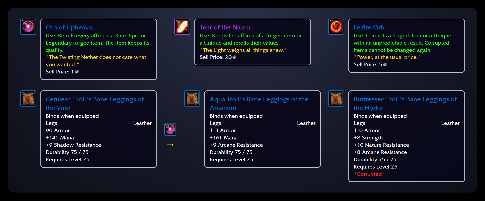
 The orbs' tooltips as the client draws them, and real rolls of Troll's Bane Leggings from the live realm: the
left pair are two rolls of the same base, as an Orb of Upheaval turns one into another; the right one came out of a
Felfire Orb with a fourth affix past the blue's cap, and is now Corrupted.

Orbs drop from any kill (`Forge.Currency.DropChance`, 2%; elites ×3, bosses ×10), one picked by its drop weight, and
disenchanting a forged item gives one half the time. Right-click an orb, then click the item, in your bags or
equipped. An orb that doesn't fit the item says why and stays in your bags.

"Forged" means a generated item; "room" means fewer affixes than its quality allows, and an affix that still fits.

| | Orb | PoE | Use: | Item | Drops |
|---|---|---|---|---|---|
| 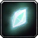 | **Shard of Awakening** | Transmutation | Awakens a plain weapon or piece of armor, giving it the fewest affixes its quality allows. | `60002` | common |
| 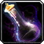 | **Alchemist's Catalyst** | Alchemy | Awakens a plain weapon or piece of armor with the most affixes its quality allows. | `60006` | uncommon |
| 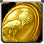 | **Gambler's Coin** | Chance | Awakens a plain weapon or piece of armor at a random quality. Rarely, it becomes Legendary, or the Unique of its base. | `60007` | uncommon |
|  | **Shifting Prism** | Alteration | Rerolls every affix on an Uncommon forged item. | `60003` | common |
|  | **Mote of Augmentation** | Augmentation | Adds one affix to an Uncommon forged item that has room for another. | `60004` | common |
| 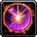 | **Orb of Upheaval** | Chaos | Rerolls every affix on a Rare, Epic or Legendary forged item. The item keeps its quality. | `60001` | uncommon |
| 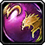 | **Sovereign Orb** | Regal | Raises a forged item one quality step (Uncommon to Rare, Rare to Epic) and adds an affix. | `60008` | rare |
| 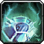 | **Eye of the Titans** | Exalted | Adds one affix to a Rare, Epic or Legendary forged item that has room for another. | `60012` | very rare |
| 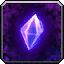 | **Void Shard** | Annulment | Removes one random affix from a forged item. | `60009` | rare |
| 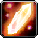 | **Tear of the Naaru** | Divine | Keeps the affixes of a forged item or a Unique and rerolls their values. | `60011` | very rare |
| 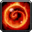 | **Felfire Orb** | Vaal | Corrupts a forged item or a Unique, with an unpredictable result. Corrupted items cannot be changed again. | `60010` | rare |
| 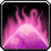 | **Scouring Dust** | Scouring | Strips every affix from a forged item, leaving the plain base. | `60005` | common |
| 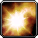 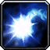  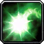 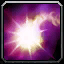 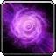 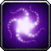 | **Essences**: Bear (Strength), Falcon (Agility), Mammoth (Stamina), Savant (Intellect), Owl (Spirit), Warlord (Attack Power), Archmage (Spell Power) | Essence | Rerolls a plain or forged weapon or piece of armor, guaranteeing that stat at grade 1. | `60013`–`60019` | very rare |
| 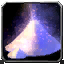 | **Sands of Nozdormu** | | Raises a Unique below level 60 to item level 63 and required level 60, with stats, armor and weapon damage to match. Drops only from bosses that guard a Unique, as often as their Unique. | `60020` | as rare as a Unique |

No orb works on a Corrupted item. Only the Tear of the Naaru, the Felfire Orb and the Sands of Nozdormu work on
Uniques: the Unique gets its own copy, with values rerolled ×0.8–1.2 (Tear), one of nothing / a reroll / one stat
×1.25 / one stat ×0.75 (Felfire), or raised (Sands; a rerolled copy keeps how far each value rolled). On a forged item the Felfire Orb rolls one of four, each a 1 in 4: nothing, new values, an affix past the
quality's count, or one affix fewer.

### Examples

What players see in chat, with the GM commands to try each one (`.additem <orb> 5`, then right-click the orb):

| Do this | Chat |
|---|---|
| `.forge roll 13114` (a blue), then an **Orb of Upheaval** on it | Your Mercenary's Troll's Bane Leggings of the Lion is reforged into Buttressed Troll's Bane Leggings of the Rhino. |
| An **Eye of the Titans** on a blue with 2 affixes | Your Buttressed Troll's Bane Leggings of the Rhino grows into Buttressed Troll's Bane Leggings of Calamity. |
| A **Tear of the Naaru** on the same item | The Light weighs your Buttressed Troll's Bane Leggings of Calamity anew: Buttressed Troll's Bane Leggings of Calamity. (same affixes, new numbers) |
| A **Shard of Awakening** on a plain green (one that dropped before Forge, or a crafted one) | Your Rigid Tunic awakens as Lacquered Rigid Tunic. |
| A **Gambler's Coin** on a plain item | The coin lands: your Dervish Tunic becomes Warlord's Dervish Tunic of the Falcon. (rarely Legendary, or its Unique) |
| An **Essence of the Bear** on a forged item | The essence binds: your Lacquered Rigid Tunic becomes Lacquered Rigid Tunic of the Titan. (Strength at grade 1, the rest rerolled) |
| A **Felfire Orb** on a forged item | Felfire empowers your Buttressed Troll's Bane Leggings of the Lion: Buttressed Troll's Bane Leggings of the Hydra. (and a red "Corrupted") |
| An orb on the wrong item | *(on screen)* Only a Rare, Epic or Legendary forged item can be upheaved. |

The item names in the chat lines are examples; every roll differs. `.forge info <entry>` shows an item's affixes,
grades, and whether it is Corrupted or a Unique copy.

## How it works

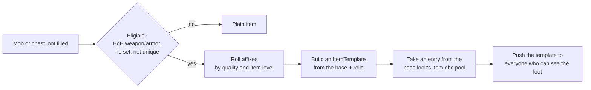

- **Real items.** Each roll is a real `ItemTemplate` with its own entry, so names, tooltips, links, trade, mail, the
  auction house and inspect all work. The client asks the server about entries it doesn't know.
- **Client pools.** Entries come from ranges reserved in the client's `Item.dbc` (1,000,000 and up), one range per
  base look, because the client takes the icon, model and equip slot from there. Players need `patch-enUS-4.MPQ`.
- **Recycling.** Entries nothing holds go back to their pool after a grace period. Their old templates are kept in
  memory until shutdown, so pointers elsewhere in the core never dangle.
- **Persistent.** The rolls are stored in the characters DB and rebuilt at startup, before auctions, guilds and
  logins load any items.

## Install

1. Clone into `azerothcore-wotlk/modules/mod-forge`.
2. Build against a core with the generated-item hooks: our fork `italicninja/azerothcore-wotlk`, branch
   `wowproject`, has them as the commit "Generated items: runtime item templates and a load hook" (aad641bd6). It adds
   the runtime item-template lookup (`ObjectMgr::SetGeneratedItemTemplateLookup`, `IsGeneratedItem`), the
   `WorldScript::OnAfterItemTemplatesLoad` hook and two null checks; cherry-pick it onto another playerbots core.
3. Apply the SQL by hand: `sql/characters/` into `acore_characters`, then `sql/world/` into `acore_world` (see
   `sql/README.md`).
4. Re-run CMake, build, and copy `conf/mod_forge.conf.dist` to `etc/modules/mod_forge.conf`.
5. Hand players the client patch built from the same `pools.tsv` and `forge-currency.json` as the SQL (it carries
   the pools' Item.dbc rows, and the orbs' items and Use: spells).

## Configuration

`etc/modules/mod_forge.conf`. Each key is documented in the `.dist` file.

| Key | Default | What |
|---|---|---|
| `Forge.Enable` | `1` | Generate new items (existing ones always load) |
| `Forge.Chance` | `100` | % of eligible drops that are forged |
| `Forge.MinQuality` / `MaxQuality` | `2` / `3` | Base qualities that can roll (our realm: `0` / `4`) |
| `Forge.BudgetMode` | `1` | Quality ladder and vanilla stat budgets (`0`: the original count-based rule) |
| `Forge.AffixGrades` | `1` | With the ladder: each affix rolls its own grade (PoE-style, more affixes = more power); `0` splits the base's stat budget |
| `Forge.Count.<Quality>` | see above | Affix count range per quality, `"min-max"` |
| `Forge.LegendaryChance` / `LegendaryBudget` | `0.5` / `1.3` | Legendary promotion (the budget multiplier only with `AffixGrades = 0`) |
| `Forge.EpicChance` / `EpicMinLevel` | `0` / `21` | Blue to purple promotion from that creature level (vanilla has almost no purples below 40) |
| `Forge.Uniques.Enable` | `1` | Uniques drop (`0`: no new ones; owned ones keep working) |
| `Forge.BudgetPerLevel` / `BudgetOffset` | `0.45` / `-3` | Budget estimate for bases without stats |
| `Forge.RecycleIntervalMinutes` / `RecycleGraceMinutes` | `30` / `120` | Entry recycling |
| `Forge.Currency.Enable` | `1` | Orbs drop, and disenchanting forged items gives them (orbs always work) |
| `Forge.Currency.DropChance` | `2` | % per creature kill (not critters) |
| `Forge.Currency.EliteMultiplier` / `BossMultiplier` | `3` / `10` | DropChance multiplier for elites and rares, and for dungeon and world bosses |
| `Forge.Currency.DisenchantChance` | `50` | % per disenchanted forged item or Unique |

Log channel: `module.forge`.

## GM commands

`.forge`, or `.affix`, the name it had before it moved into this module.

| Command | What |
|---|---|
| `.forge roll <base> [ilvl] [prefixes] [suffixes]` | Roll a generated item into your bags (counts 1–3, random when omitted) |
| `.forge legendary <base> [ilvl]` | Roll a Legendary |
| `.forge unique [key]` | List the Uniques, or give yourself one |
| `.forge info <entry>` | Show what a generated item rolled |
| `.forge reroll <entry>` | What an Orb of Upheaval does, on an item you carry or wear, without the orb or its quality rule |

## For other modules

`src/ForgeMgr.h` is the API. `sForgeMgr->Generate()` rolls an item, `CreatePreview()` makes a reward preview, and
`SendTemplate()` pushes a template to a client. mod-procedurality rolls its Wanted rewards with it. Code that only
needs to know whether an entry is generated should call core's `ObjectMgr::IsGeneratedItem`, as mod-playerbots does
to keep bots' forged gear.

## Status

Extracted on 2026-10-20 from the wowproject core patches `0001-item-affixes` and `0006-item-affix-spells`, where
the code ran live from 2026-10-13. Live as a module since 2026-10-21 on the wowproject realm. The design docs (`docs/loot-affixes.md`,
`docs/loot-vanilla-plan.md`, `docs/uniques-draft.md`) and the data generators (`tools/item-affixes/`,
`tools/client-patch/`) live in the wowproject repo for now.

## License

GPL-2.0, like AzerothCore. See `LICENSE`.
