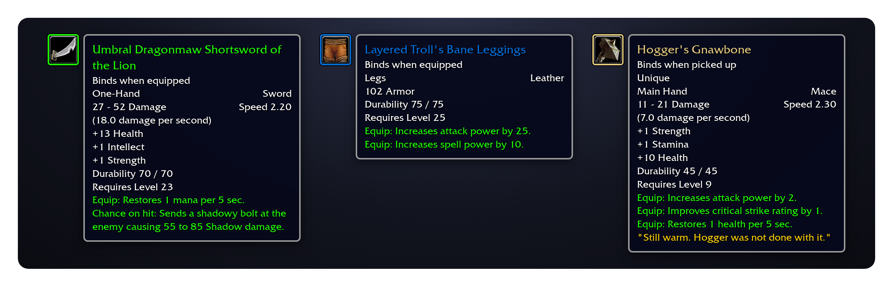
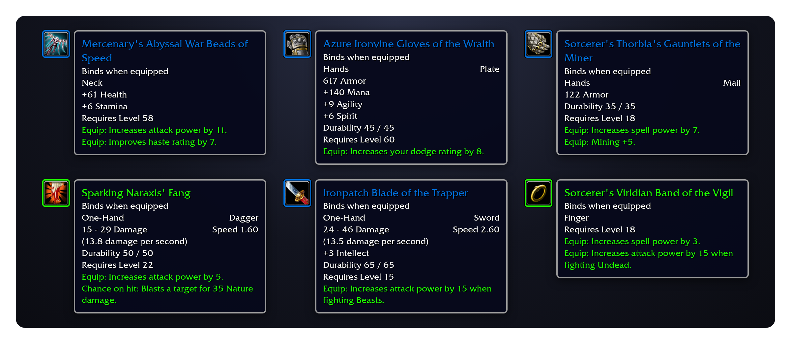
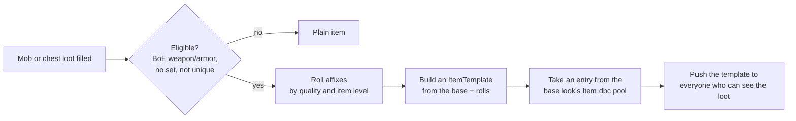

# mod-forge

**Path of Exile-style generated loot for AzerothCore 3.3.5a**

Every eligible drop is forged into a one-of-a-kind item, with its own name, stats and procs.

## What drops

| | |
|---|---|
| **Affixed items** | The base item keeps its look, armor and weapon damage. Its stats are replaced by prefixes and suffixes whose values split the base's vanilla stat budget, so power stays in line with the original game. *Vicious Chain Leggings of the Bear.* |
| **Spell affixes** | One "Equip:" effect or "Chance on hit:" proc per item, taken from existing Spell.dbc spells, so the client draws the line itself. |
| **Legendaries** | A small share of purple drops turn orange, with 4–6 affixes and 1.3× the budget. |
| **Uniques** | Hand-authored items in light gold, each dropped by one named creature, with fixed stats and flavour text. |

 Real drops from a live realm, drawn from their database rows in the client's tooltip font.

## The quality ladder

An item keeps its base item's quality. The quality decides how many affixes roll:

| Quality | Affixes | Notes |
|---|---|---|
| ◽ Poor (grey) | 0–1 | Kept plain on our realm (`"0-0"`): there are so many greys that they filled the busiest pools within an hour |
| ⬜ Common (white) | 0–1 | |
| 🟩 Uncommon (green) | 1–2 | |
| 🟦 Rare (blue) | 2–3 | |
| 🟪 Epic (purple) | 3–4 | |
| 🟧 Legendary (orange) | 4–6 | `Forge.LegendaryChance` (0.5%) of eligible purple drops, 1.3× budget |
| 🟨 Unique (light gold) | fixed | Bind on pickup, one per character, separate roll on its creature |

Prefixes and suffixes go up to three each. The item level of the drop (the mob's level) decides which affix tiers
can roll; tiers set the affix's name, the budget sets its value.

## How it works

- **Real items.** Each roll is a real `ItemTemplate` with its own entry, so names, tooltips, links, trade, mail, the
  auction house and inspect all work. The client asks the server about entries it doesn't know.
- **Client pools.** Entries come from ranges reserved in the client's `Item.dbc` (1,000,000 and up), one range per
  base look, because the client takes the icon, model and equip slot from there. Players need `patch-enUS-4.MPQ`.
- **Recycling.** Entries nothing holds go back to their pool after a grace period. Their old templates are kept in
  memory until shutdown, so pointers elsewhere in the core never dangle.
- **Persistent.** The rolls are stored in the characters DB and rebuilt at startup, before auctions, guilds and
  logins load any items.

## Install

1. Clone into `azerothcore-wotlk/modules/mod-forge`.
2. Apply the core patch `0001-generated-item-hooks`. It adds the runtime item-template lookup
   (`ObjectMgr::SetGeneratedItemTemplateLookup`, `IsGeneratedItem`), the `WorldScript::OnAfterItemTemplatesLoad`
   hook and two null checks.
3. Apply the SQL by hand: `sql/characters/` into `acore_characters`, then `sql/world/` into `acore_world` (see
   `sql/README.md`).
4. Re-run CMake, build, and copy `conf/mod_forge.conf.dist` to `etc/modules/mod_forge.conf`.
5. Hand players the client patch built from the same `pools.tsv` as the pool SQL.

## Configuration

`etc/modules/mod_forge.conf`. Each key is documented in the `.dist` file.

| Key | Default | What |
|---|---|---|
| `Forge.Enable` | `1` | Generate new items (existing ones always load) |
| `Forge.Chance` | `100` | % of eligible drops that are forged |
| `Forge.MinQuality` / `MaxQuality` | `2` / `3` | Base qualities that can roll (our realm: `0` / `4`) |
| `Forge.BudgetMode` | `1` | Quality ladder and vanilla stat budgets (`0`: the original count-based rule) |
| `Forge.Count.<Quality>` | see above | Affix count range per quality, `"min-max"` |
| `Forge.LegendaryChance` / `LegendaryBudget` | `0.5` / `1.3` | Legendary promotion |
| `Forge.BudgetPerLevel` / `BudgetOffset` | `0.45` / `-3` | Budget estimate for bases without stats |
| `Forge.RecycleIntervalMinutes` / `RecycleGraceMinutes` | `30` / `120` | Entry recycling |

Log channel: `module.forge`.

## GM commands

`.forge`, or `.affix`, the name it had before it moved into this module.

| Command | What |
|---|---|
| `.forge roll <base> [ilvl] [prefixes] [suffixes]` | Roll a generated item into your bags (counts 1–3, random when omitted) |
| `.forge legendary <base> [ilvl]` | Roll a Legendary |
| `.forge unique [key]` | List the Uniques, or give yourself one |
| `.forge info <entry>` | Show what a generated item rolled |

## For other modules

`src/ForgeMgr.h` is the API. `sForgeMgr->Generate()` rolls an item, `CreatePreview()` makes a reward preview, and
`SendTemplate()` pushes a template to a client. mod-procedurality rolls its Wanted rewards with it. Code that only
needs to know whether an entry is generated should call core's `ObjectMgr::IsGeneratedItem`, as mod-playerbots does
to keep bots' forged gear.

## Status

Extracted on 2026-10-20 from the wowproject core patches `0001-item-affixes` and `0006-item-affix-spells`, where
the code ran live from 2026-10-13. Not yet built as a module. The design docs (`docs/loot-affixes.md`,
`docs/loot-vanilla-plan.md`, `docs/uniques-draft.md`) and the data generators (`tools/item-affixes/`,
`tools/client-patch/`) live in the wowproject repo for now.

## License

GPL-2.0, like AzerothCore. See `LICENSE`.
